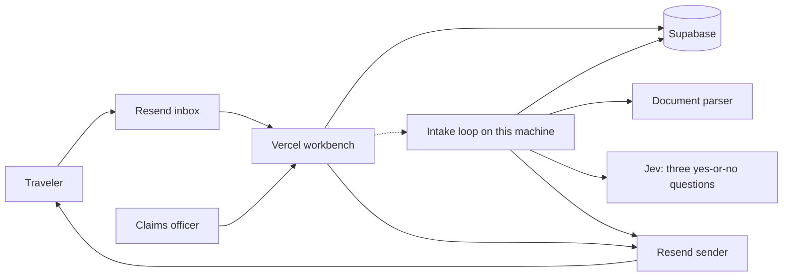
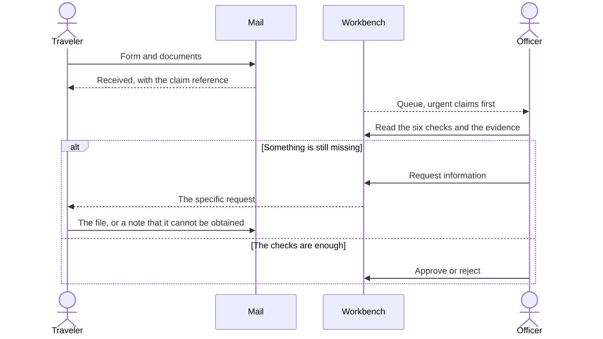
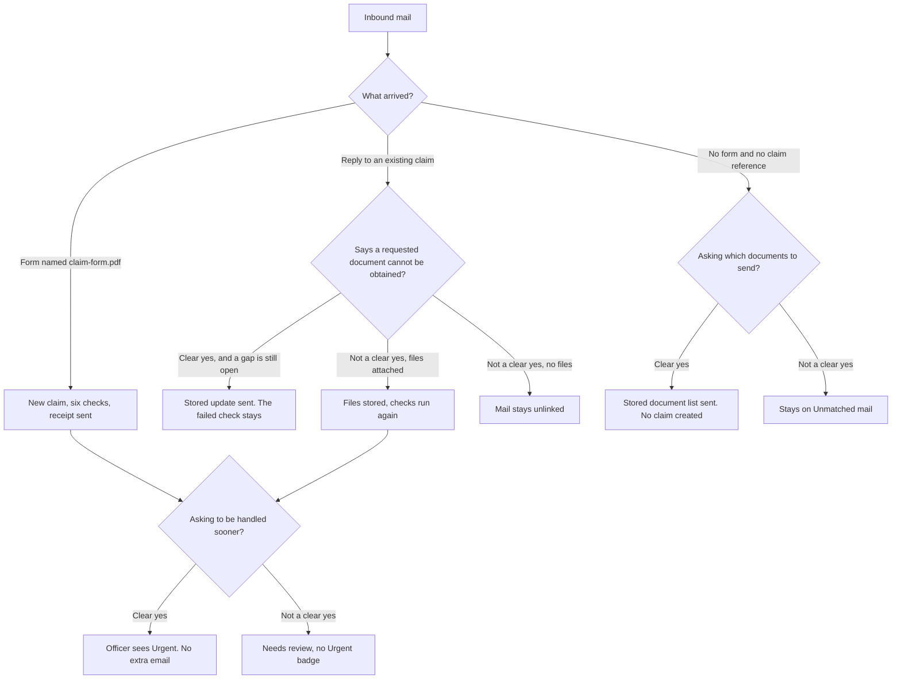

# Using SureCover

SureCover is a fictional flight-delay claims demonstration. A traveler sends documents by email. A claims officer reads the checks and the evidence, then records the decision.

The workbench is [surecover-ai-claims-prototype.vercel.app](https://surecover-ai-claims-prototype.vercel.app).

Send documents to `claims@eeelkoizil.resend.app`. Replies come from `claims@claims.refund.casa`.

New mail becomes a claim while the intake machine is awake. Mail that arrives while that machine is asleep stays stored and is picked up on the next pass.

## Architecture

Vercel stores the incoming mail and shows the workbench. The intake loop on this machine reads the documents, runs the six checks, asks Jev, and sends the reply. The dotted line is that handoff. The officer signs in to the workbench, and each officer sees only the claims assigned to them.

The six checks are fixed rules. Jev answers only the three questions in the chart below. A generative language model is not part of this demonstration. Dates and flight numbers stay with the document parser.

## Traveler and officer

### Sending a claim

Attach a PDF named `claim-form.pdf`. The form needs three lines: `Claimant:`, `Policy reference:`, and `Return to Singapore:` followed by a date. The subject can be anything.

Send the supporting documents in the same email: the scheduled itinerary, the revised itinerary, the delay letter, and a boarding pass for each flight. PDF, PNG, and JPEG files are accepted.

The receipt subject is `Received`, followed by a reference such as `CLM-LIVE-…`. The body greets the name on the form and says the claim was received.

### Replying

Put that claim reference in the subject, for example `Re: Received CLM-LIVE-…`. A subject that names a `CLM-DEMO-` claim is left unchanged.

A reply can bring the missing file, or it can say the requested document cannot be obtained. A file is checked again. A clear statement that the document cannot be obtained sends `Update for` that reference and leaves the failed check in place.

### Asking what to send

An email with no `claim-form.pdf` and no claim reference can ask which documents to send. A clear question receives `Documents to send` and does not become a claim. The list is the claim form, the scheduled itinerary, the revised itinerary, the delay letter, and a boarding pass for each flight. That mail stays on the officer’s Unmatched mail page.

### What the officer sees

The queue lists urgent claims first, then the most recently received. A claim can show three signals:

- **Urgent.** A linked message was read as frustrated, or as asking for the claim to be handled sooner.
- **Action needed.** The claim is waiting for an officer. Its status is `needs review`.
- **Check failed.** The latest assessment has a check that failed, or a check whose result could not be established.

Opening a claim shows the documents, the extracted facts, and six checks. Each check is **pass**, **fail**, or **unknown**.

| Check | What it looks at |
| --- | --- |
| Completeness | The claim form, both itineraries, the delay letter, and a boarding pass for each flight |
| Filing deadline | 30 working days after the return to Singapore |
| Coverage | Each flight’s departure date against the demonstration coverage period |
| Claim type | The form says flight delay, and a delay letter is on file |
| Consistency | Flight details agree across the documents, including the return date |
| Delay | The delay letter shows at least 6 hours |

The 30 working days and the 6 hour delay are fictional demonstration assumptions. They are labeled as such on the claim. Every message ends with: “Fictional demonstration data. Not a SureCover policy document.”

The officer can request information, approve, or reject. Request information sends `Information requested for` that reference. The sentences about a missing boarding pass, an unclear photo, or two disagreeing return dates are stored. The officer adds the reason in their own words. Approve and reject record the decision and send no email. An approval names each failed or unknown check in the reason. After a request, the request button is gone. After an approval or a rejection, the decision buttons are gone.

## Jev

Jev reads one yes-or-no question at a time. A score of 0.75 or higher is a clear yes. A lower score, or no answer, leaves the ordinary path in place. Jev does not send its own wording. A clear yes uses a stored sentence, or, for urgency, only a badge.

The three questions are:

- Is the traveler frustrated or asking for the claim to be handled sooner?
- Does the traveler say a requested document is missing or cannot be obtained?
- Is the traveler asking which documents to send?

The sooner question is asked when a message is about to be linked to a claim, including the first email that opens the claim. The document question is asked only while the officer is waiting for information and a boarding-pass gap is still open. The documents-to-send question is asked only when the email has no claim form and names no claim.
